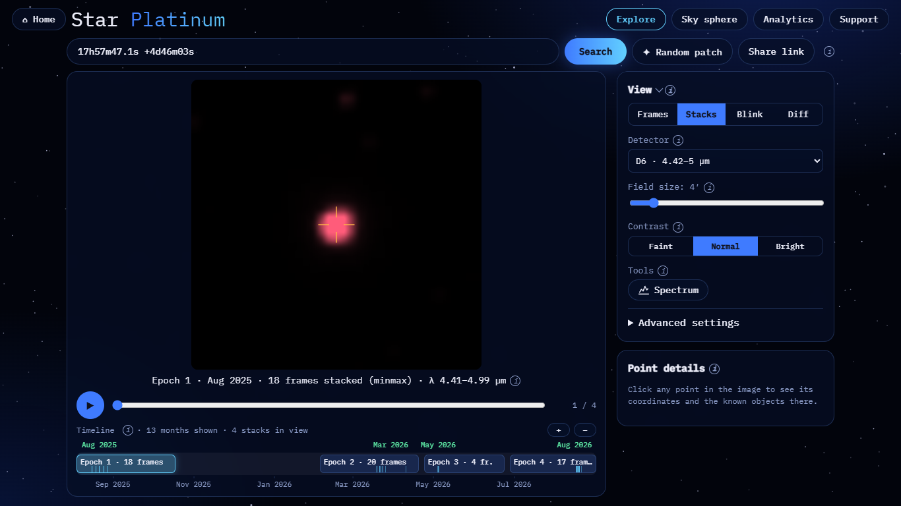
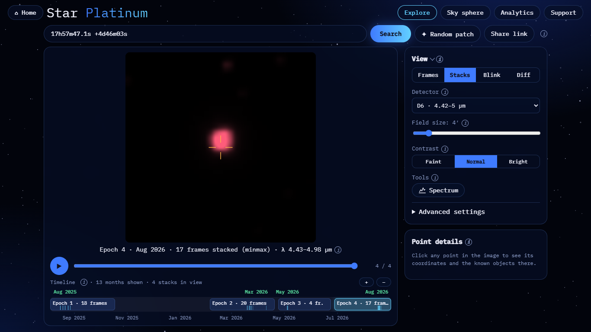
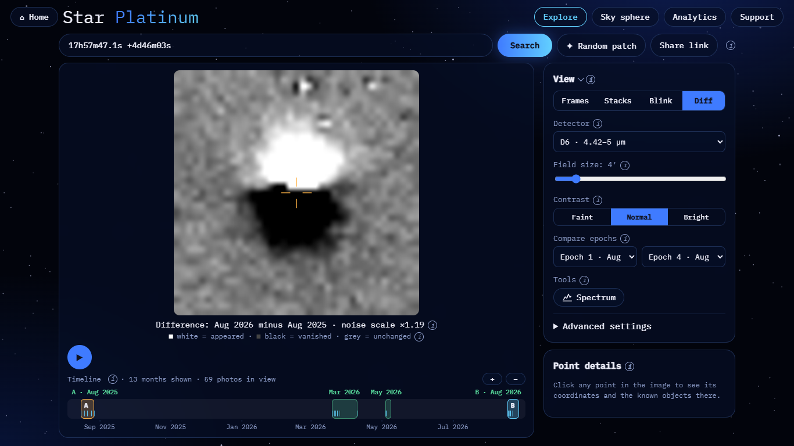
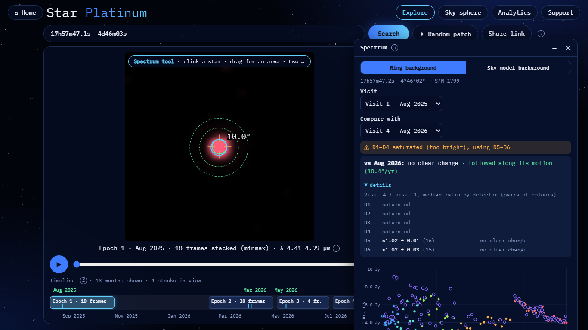

# Barnard's Star: proper motion

**Result: motion is clearly visible.** In one year the star moves 10.3″ (1.7 SPHEREx pixels) to the north, and the
measured shift agrees with Gaia DR3 to within 0.7″ (0.1 px).

| | |
|---|---|
| Detector | D6 (4.42–5.00 µm). D1–D4 are saturated in the core; D6 has the fewest bad pixels |
| Field | 4′ |
| Epoch A | Epoch 1, Aug 2025: 18 frames stacked (minmax) |
| Epoch B | Epoch 4, Aug 2026: 17 frames stacked (minmax) |
| Pixel | 6.15″ |

## Reproduce

- Epoch A: <https://blink-comparator.de/?q=17h57m47.1s+%2B4d46m03s&det=6&fov=4&mode=stacks&same=1&i=0#explore>
- Epoch B: <https://blink-comparator.de/?q=17h57m47.1s+%2B4d46m03s&det=6&fov=4&mode=stacks&same=1&i=3#explore>
- Blink: <https://blink-comparator.de/?q=17h57m47.1s+%2B4d46m03s&det=6&fov=4&mode=blink&same=1&ea=0&eb=3#explore>
- Diff: <https://blink-comparator.de/?q=17h57m47.1s+%2B4d46m03s&det=6&fov=4&mode=diff&same=1&ea=0&eb=3#explore>
- Spectrum: <https://blink-comparator.de/?q=17h57m47.1s+%2B4d46m03s&det=6&fov=4&mode=stacks&same=1&i=0&tool=spectrum#explore>.
  Click the star, then set Compare with → Visit 4 · Aug 2026.

The crosshair marks the query position (the star's position around late 2025), and it stays fixed between epochs.

## What is seen

| Epoch A | Epoch B | Diff (B − A) |
|---|---|---|
|  |  |  |

- **Blink.** The star jumps north relative to the crosshair and to the field stars.
- **Diff.** The difference image shows a white blob to the north ("appeared") and a black blob to the south
  ("vanished"): the classic dipole of a moving source.
- **Spectrum window.** The Ring background is snapped to the star with S/N 1799. "Compare with" follows the star
  along its Gaia DR3 motion of 10.4″/yr and reports "no clear change" in brightness (D5 ×1.02 ± 0.01, D6
  ×1.02 ± 0.03). D1–D4 are flagged as saturated and are not used.

## Numbers

Motion between the first and last epoch (0.99 yr), measured relative to 20 field stars:

| | ΔRA·cos Dec | ΔDec | Total |
|---|---|---|---|
| Measured, D6 | −1.47 ± 0.15″ | +10.19 ± 0.07″ | 10.30″ = 1.67 px |
| Gaia DR3 prediction | −0.79″ | +10.26″ | 10.29″ = 1.67 px |

- **S/N.** 15 000–18 800 per epoch (aperture photometry on the stacks).
- **RA offset.** The 0.68″ difference in RA is formally 4.5σ, but it stays under our ~0.5–1″ (0.1–0.15 px)
  systematic limit of stack astrometry.
- **D5 cross-check.** D5 gives −2.21 ± 0.04″, +10.23 ± 0.08″. Its RA offset (1.4″) goes beyond that limit; the core
  is partly saturated there too.

Source: `demo/target_check.py` (2026-11-07), `docs/results/target_check_2026-11-07.md`; screenshots taken with
`docs/ui/tools/target_screens.py`.
