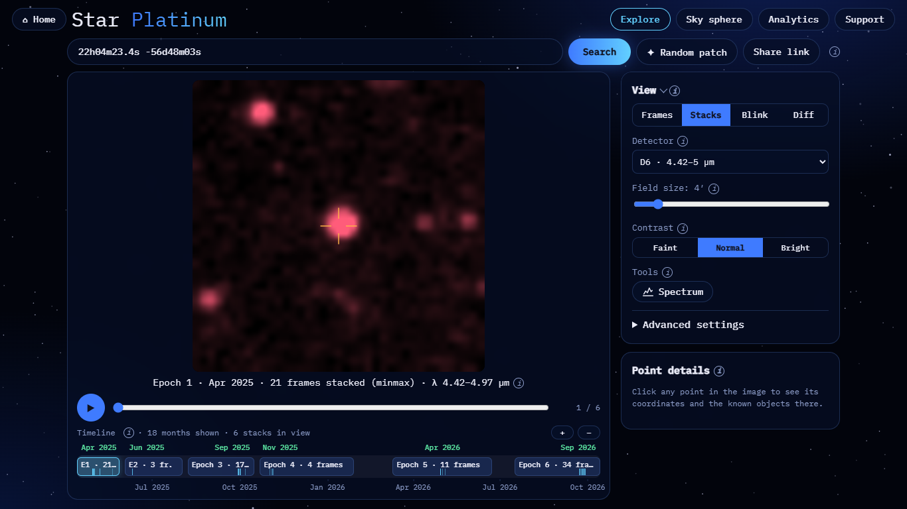
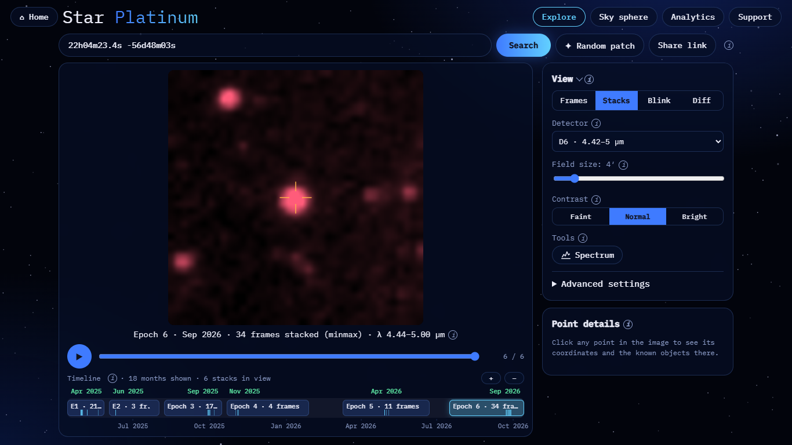
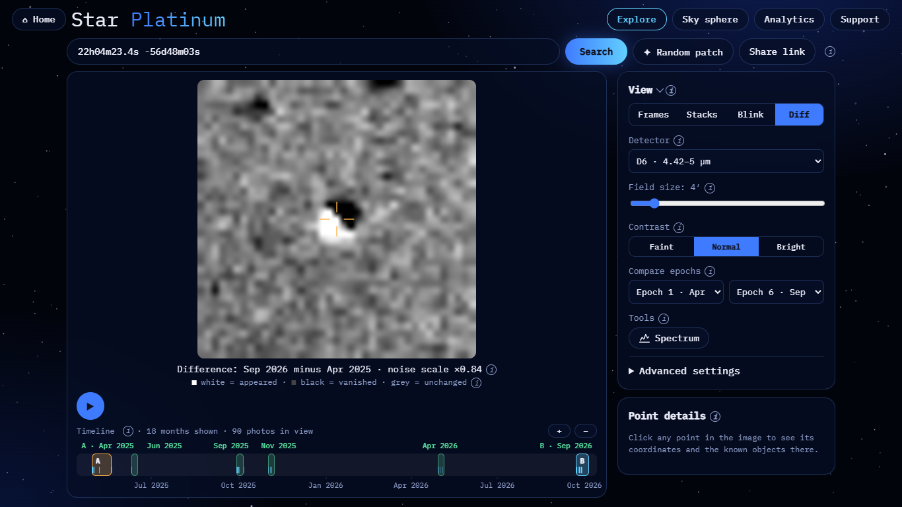
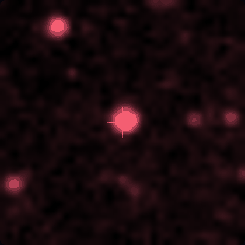
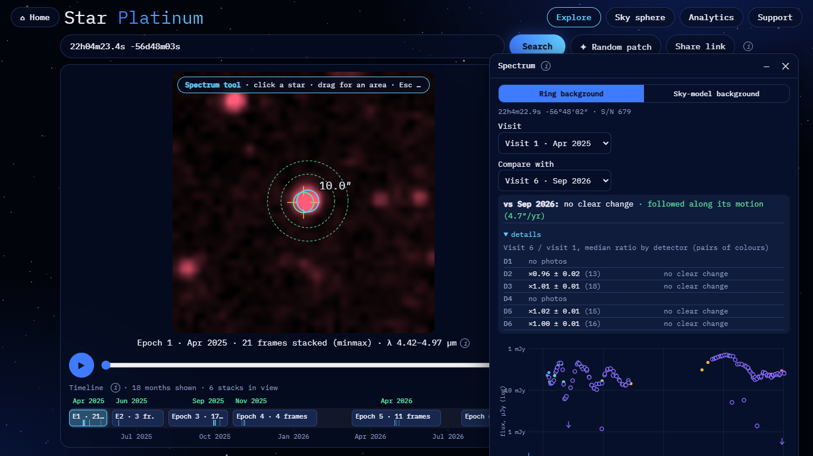

# Epsilon Indi B: proper motion

**Result: motion is visible.** Over 1.4 years the brown-dwarf pair moves 6.4″ (about 1 SPHEREx pixel) to the
south-east, in agreement with Gaia DR3 within 2.5σ.

| | |
|---|---|
| Detector | D6 (4.42–5.00 µm). The source is not saturated |
| Field | 4′ |
| Epoch A | Epoch 1, Apr 2025: 21 frames stacked |
| Epoch B | Epoch 6, Sep 2026: 34 frames stacked |
| Pixel | 6.15″ |

## Reproduce

- Epoch A: <https://blink-comparator.de/?q=22h04m23.4s+-56d48m03s&det=6&fov=4&mode=stacks&same=1&i=0#explore>
- Epoch B: <https://blink-comparator.de/?q=22h04m23.4s+-56d48m03s&det=6&fov=4&mode=stacks&same=1&i=5#explore>
- Blink: <https://blink-comparator.de/?q=22h04m23.4s+-56d48m03s&det=6&fov=4&mode=blink&same=1&ea=0&eb=5#explore>
- Diff: <https://blink-comparator.de/?q=22h04m23.4s+-56d48m03s&det=6&fov=4&mode=diff&same=1&ea=0&eb=5#explore>
- Spectrum: <https://blink-comparator.de/?q=22h04m23.4s+-56d48m03s&det=6&fov=4&mode=stacks&same=1&i=0&tool=spectrum#explore>.
  Click the source, then set Compare with → Visit 6 · Sep 2026.

## What is seen

| Epoch A | Epoch B | Diff (B − A) |
|---|---|---|
|  |  |  |

- **Diff.** A compact dipole sits at the crosshair: black (vanished) to the north-west and white (appeared) to the
  south-east, which is the direction of the Gaia motion (+RA, −Dec).
- **Blink.** The shift is about 1 pixel, so it is subtle but visible in the blink.
- **Spectrum window.** The Ring background has S/N 679. The comparison follows the source along its Gaia DR3 motion
  of 4.7″/yr and finds no brightness change (D2 ×0.96 ± 0.02, D3 ×1.01 ± 0.01, D5 ×1.02 ± 0.01, D6 ×1.00 ± 0.01).
- **Binary.** Ba and Bb are not resolved: their separation is far below the 6.15″ pixel.

## Numbers

Motion between the first and last epoch (1.41 yr in D6, 1.43 yr in D5), measured relative to the field stars:

| | ΔRA·cos Dec | ΔDec | Total | S/N per epoch |
|---|---|---|---|---|
| Measured, D6 | +5.03 ± 0.47″ | −4.02 ± 0.22″ | 6.44″ = 1.05 px | 96–191 |
| Measured, D5 | +5.21 ± 0.27″ | −4.03 ± 0.24″ | 6.59″ = 1.07 px | 366–394 |
| Gaia DR3 prediction | +5.60″ / +5.69″ | −3.47″ / −3.53″ | 6.6″ = 1.07 px | |

Both detectors agree with Gaia within 3σ (2.5σ in D6, 2.1σ in D5). The ~0.5″ offsets are at the systematic limit of
stack astrometry (0.5–1″).

Source: `demo/target_check.py` (2026-11-07), `docs/results/target_check_2026-11-07.md`; screenshots taken with
`docs/ui/tools/target_screens.py`.
