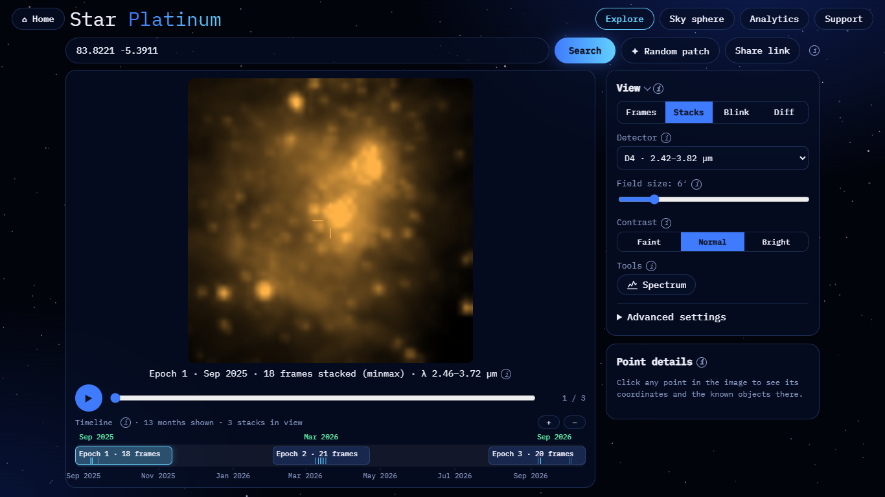
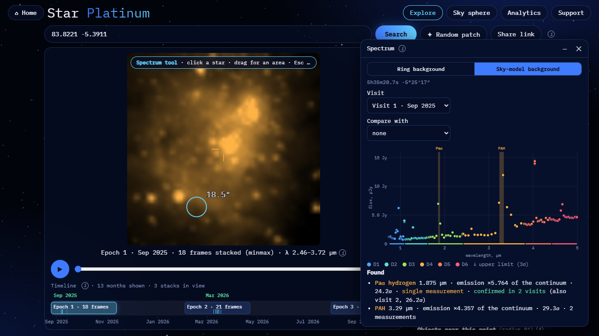

# Orion Nebula (bonus): spectral features

**Result: the hydrogen Paschen-α line and the 3.3 µm PAH band are detected at high significance.** The spectrum is
measured from all SPHEREx photos of one visit in an 18.5″ area south-east of the Trapezium.

| | |
|---|---|
| Detector (pictures) | D4 (2.42–3.82 µm); the spectrum uses all six detectors |
| Field | 6′ |
| Visit | Visit 1, Sep 2025: 18 frames in the D4 stack. The spectrum uses ±10 days of all detectors |
| Area | a circle of 18.5″ centred on 5h35m20.7s −5°25′17″, drawn by dragging. Sky-model background: IMAGE − ZODI, no aperture correction |

## Reproduce

- Picture: <https://blink-comparator.de/?q=83.8221+-5.3911&det=4&fov=6&mode=stacks&same=1&i=0#explore>
- Spectrum: <https://blink-comparator.de/?q=83.8221+-5.3911&det=4&fov=6&mode=stacks&same=1&i=0&tool=spectrum#explore>.
  Drag a circle of ~18″ starting at about 36% from the left and 80% from the top of the picture. A dragged circle
  uses the Sky-model background by default.

## What is seen

| Stack, Sep 2025 | Spectrum |
|---|---|
|  |  |

| Feature | Wavelength | Strength | Significance |
|---|---|---|---|
| Paα hydrogen | 1.875 µm | ×5.76 of the continuum | 24.2σ in one measurement; confirmed in visit 2 (26.2σ) |
| PAH | 3.29 µm | ×4.36 of the continuum | 29.3σ, 2 measurements |

Two more files are kept for completeness:
- `epoch_b.png`, the Sep 2026 stack;
- `diff.png`, the difference of the two stacks. The nebula itself is not expected to change; the noise scale ×16
  shows how bright the field is.

**Caveats.**
- With a Ring background instead (for point sources), the same circle gives "No point source found here" and mostly
  upper limits: a background ring removes the nebula itself.
- Feature detection needs ≥3σ in 3 neighbouring colours, or ≥5σ where a visit has only one or two colours on the
  line. A feature seen in a single measurement is then looked for in other visits.

Screenshots taken with `docs/ui/tools/target_screens.py`.
