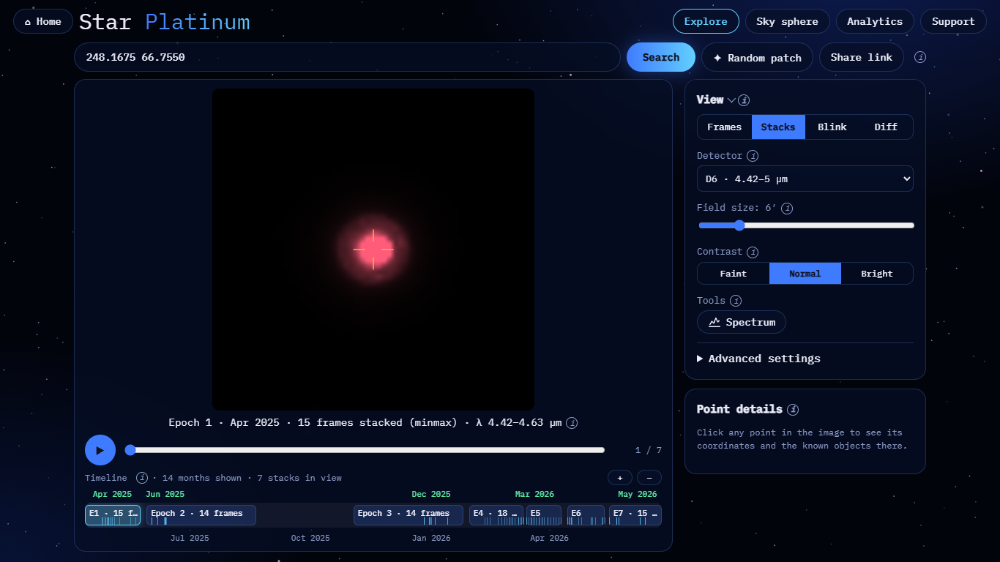
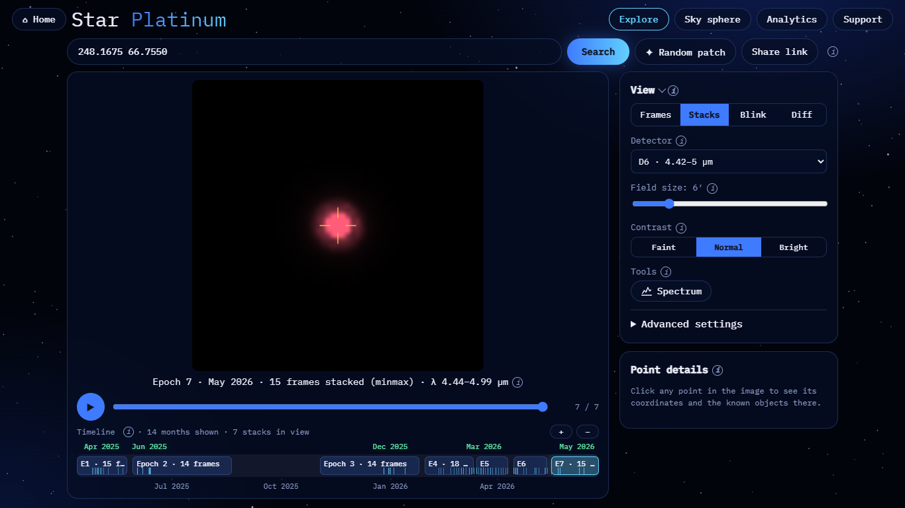
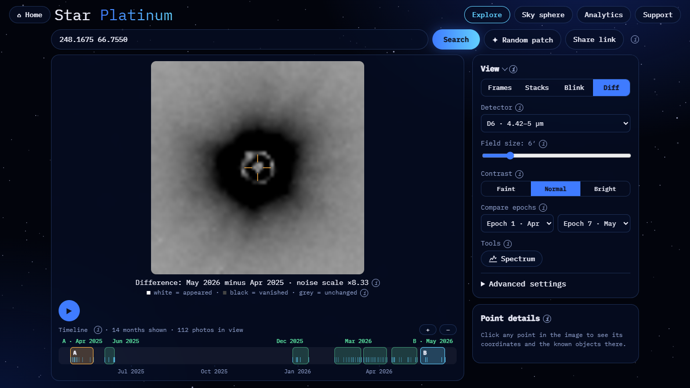
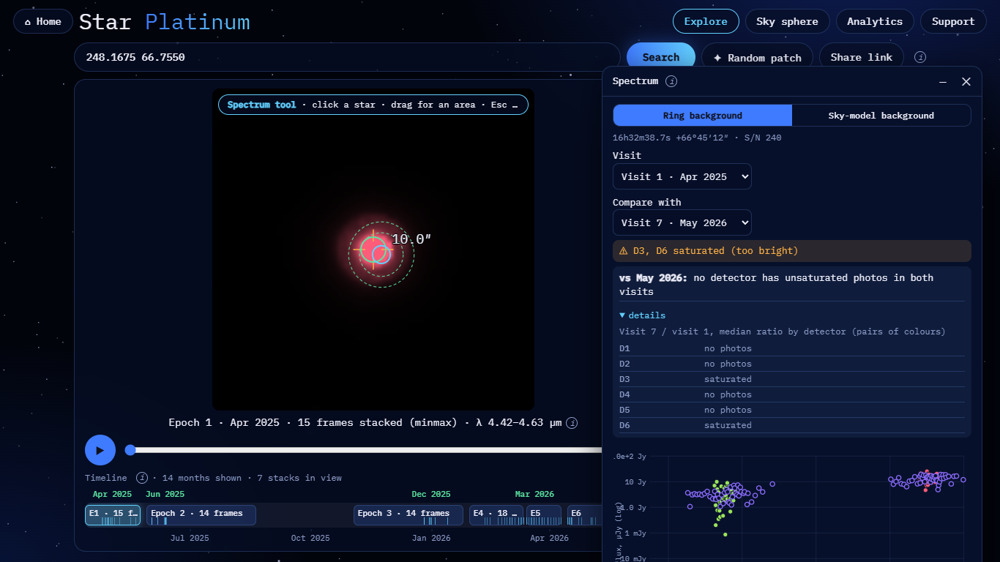

# R Draconis: brightness change

**Result: the fading is visible, but the amount is uncertain.** R Dra is a Mira variable so bright in the infrared
that its core is saturated in all six detectors. Blink and Diff show it clearly fainter in May 2026 than in
Apr 2025. The size of the change comes from the wings of the image (−44%), not from a clean measurement. The
Spectrum window cannot compare visits for this star.

| | |
|---|---|
| Detector | D6 (4.42–5.00 µm): the fewest saturated pixels (4.7 per frame) |
| Field | 6′ |
| Epoch A | Epoch 1, Apr 2025: 15 frames, λ 4.42–4.63 µm |
| Epoch B | Epoch 7, May 2026: 15 frames, λ 4.44–4.99 µm |
| Contrast | the same for both epochs (`same=1`) |

## Reproduce

- Epoch A: <https://blink-comparator.de/?q=248.1675+66.7550&det=6&fov=6&mode=stacks&same=1&i=0#explore>
- Epoch B: <https://blink-comparator.de/?q=248.1675+66.7550&det=6&fov=6&mode=stacks&same=1&i=6#explore>
- Blink: <https://blink-comparator.de/?q=248.1675+66.7550&det=6&fov=6&mode=blink&same=1&ea=0&eb=6#explore>
- Diff: <https://blink-comparator.de/?q=248.1675+66.7550&det=6&fov=6&mode=diff&same=1&ea=0&eb=6#explore>
- Spectrum: <https://blink-comparator.de/?q=248.1675+66.7550&det=6&fov=6&mode=stacks&same=1&i=0&tool=spectrum#explore>.
  Click the star.

## What is seen

| Epoch A | Epoch B | Diff (B − A) |
|---|---|---|
|  |  |  |

- **Blink.** With the same contrast, the halo of the star is clearly smaller in May 2026.
- **Diff.** A large black halo ("vanished" light) surrounds the star. The ring at the centre is the saturated core,
  filled from its neighbours, so it is not a real structure. Note the noise scale ×8.3: the change is far above
  the noise.
- **Spectrum window.** The window reports "D3, D6 saturated (too bright)" and "no detector has unsaturated photos
  in both visits":
  - near the ecliptic pole SPHEREx covers R Dra in alternating detector pairs (D3 + D6, D1 + D4, D2 + D5) in
    different months;
  - in the visits where D2 / D5 are present, every detector is saturated;
  - so there is no honest per-detector flux ratio, and the window does not invent one.

## Numbers

PSF-wing photometry in D6 (`demo/target_check.py`): ring 4–8 px, background 14–18 px, normalised to 5 stable field
stars.

| Epoch | Brightness, MJy/sr·px | Change vs first |
|---|---|---|
| May 2025 | 4502 | 0 |
| Jun 2025 | 4417 | −1.9% |
| Dec 2025 | 4268 | −5.2% |
| Mar 2026 | 4281 | −4.9% |
| Mar–Apr 2026 | 3803 | −15.5% |
| Apr 2026 | 3210 | −28.7% |
| May 2026 | 2521 | −44.0% |

The range is 79%, while the control stars vary by 4.8% (median).

**Why "uncertain":**
- **Saturated core.** Saturated pixels per frame: D1 9.8, D2 11.3, D3 18.3, D4 24.9, D5 8.1, D6 4.7.
- **PSF assumption.** The wing method assumes a stable PSF.
- **Mixed bands.** The epochs cover different wavelength ranges inside D6 (4.42–4.63 vs 4.44–4.99 µm).
- **Missing period.** A Mira period of ~245 days is not seen in the data.
- **Artefacts.** Most "stars" within 12′ are artefacts of R Dra (diffraction spikes and ghosts) that rotate with
  the frame orientation.

Source: `demo/target_check.py` (2026-11-07), `docs/results/target_check_2026-11-07.md`; screenshots taken with
`docs/ui/tools/target_screens.py`.
