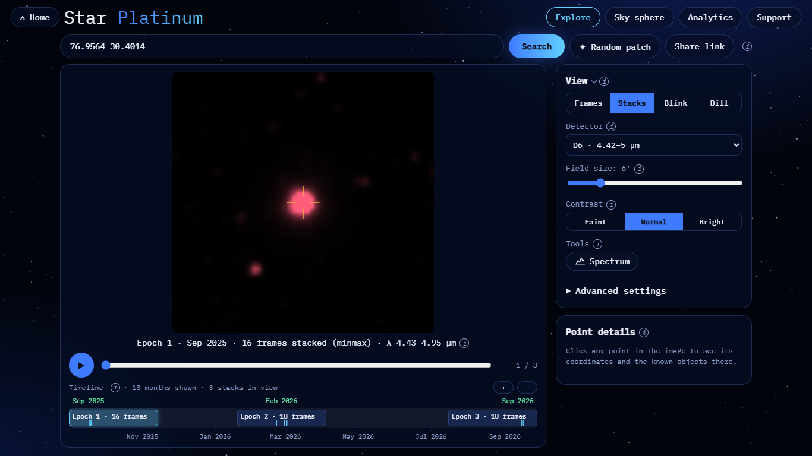
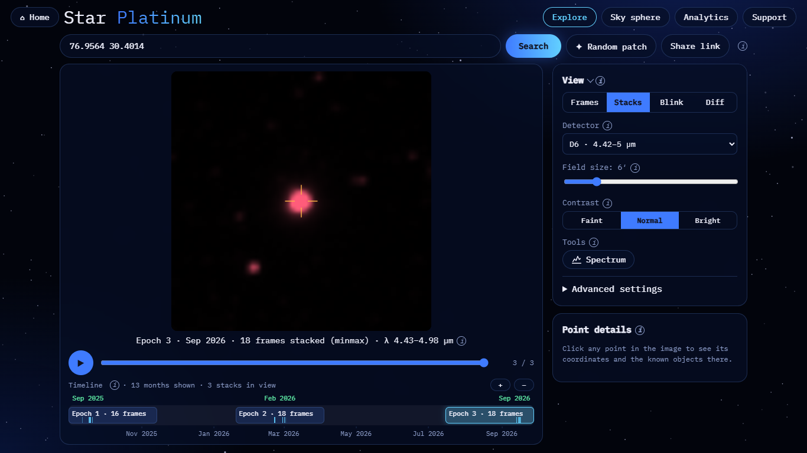
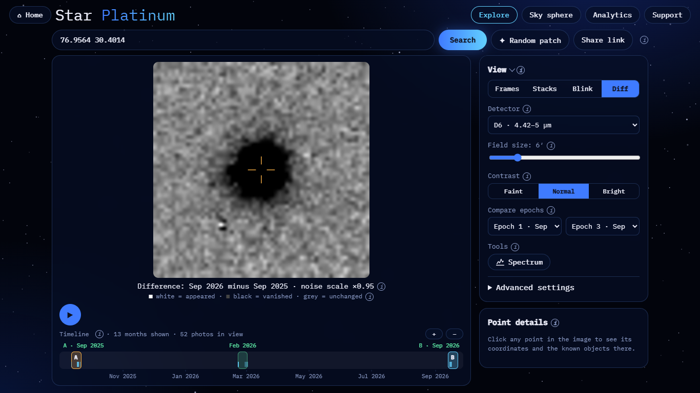
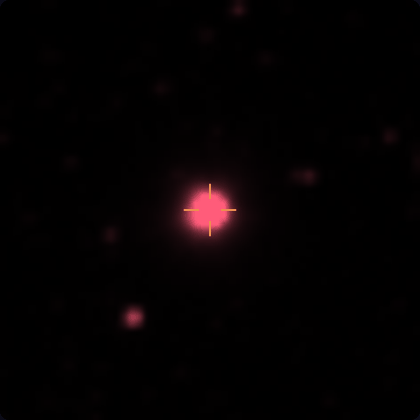
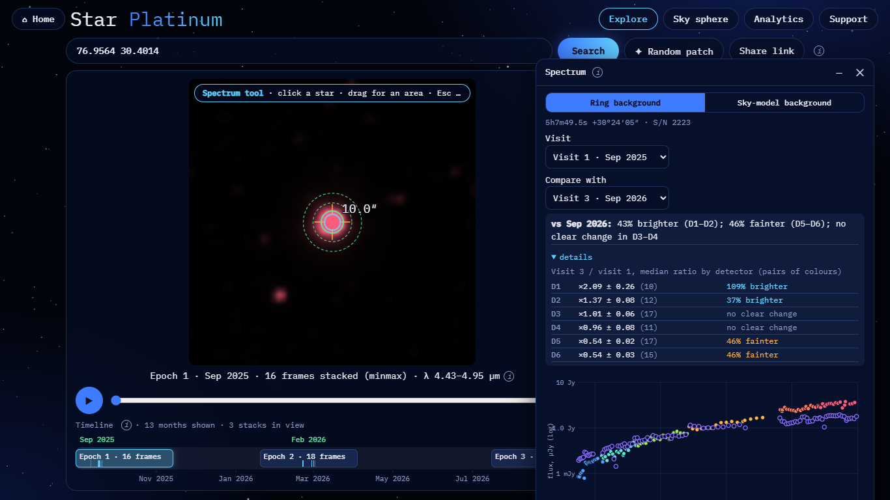

# RW Aurigae: brightness change

**Result: a strong change is visible and measured.** Between Sep 2025 and Sep 2026 RW Aur fades by about half at
4–5 µm (D5–D6 ×0.54) while it brightens at 0.75–1.6 µm (D1–D2). The control stars change by about 5%.

| | |
|---|---|
| Detector (pictures) | D6 (4.42–5.00 µm). The source is not saturated (0 bad pixels in the core) |
| Field | 6′ |
| Epoch A | Epoch 1, Sep 2025: 16 frames |
| Epoch B | Epoch 3, Sep 2026: 18 frames |
| Contrast | the same for both epochs (`same=1`), so brightness can be compared by eye |

## Reproduce

- Epoch A: <https://blink-comparator.de/?q=76.9564+30.4014&det=6&fov=6&mode=stacks&same=1&i=0#explore>
- Epoch B: <https://blink-comparator.de/?q=76.9564+30.4014&det=6&fov=6&mode=stacks&same=1&i=2#explore>
- Blink: <https://blink-comparator.de/?q=76.9564+30.4014&det=6&fov=6&mode=blink&same=1&ea=0&eb=2#explore>
- Diff: <https://blink-comparator.de/?q=76.9564+30.4014&det=6&fov=6&mode=diff&same=1&ea=0&eb=2#explore>
- Spectrum: <https://blink-comparator.de/?q=76.9564+30.4014&det=6&fov=6&mode=stacks&same=1&i=0&tool=spectrum#explore>.
  Click the star, then set Compare with → Visit 3 · Sep 2026.

## What is seen

| Epoch A | Epoch B | Diff (B − A) |
|---|---|---|
|  |  |  |

- **Blink.** With the same contrast in both epochs, the star is visibly smaller and dimmer in Sep 2026.
- **Diff.** The difference image is a round black blob ("vanished" light) centred on the star, with no white
  counterpart: a pure fading, not a motion.
- **Spectrum window.** "Compare with" gives "43% brighter (D1–D2); 46% fainter (D5–D6); no clear change in D3–D4".

## Numbers

Flux ratio Sep 2026 / Sep 2025 per detector. Ring background, S/N 2223; this is the median over pairs of matching
colours:

| Detector | Ratio | Change |
|---|---|---|
| D1 (0.75–1.10 µm) | ×2.09 ± 0.26 (10 pairs) | +109% |
| D2 (1.10–1.62 µm) | ×1.37 ± 0.08 (12) | +37% |
| D3 (1.62–2.42 µm) | ×1.01 ± 0.06 (17) | no clear change |
| D4 (2.42–3.82 µm) | ×0.96 ± 0.08 (11) | no clear change |
| D5 (3.82–4.42 µm) | ×0.54 ± 0.02 (17) | −46% |
| D6 (4.42–5.00 µm) | ×0.54 ± 0.03 (15) | −46% |

Independent check in D6 (`demo/target_check.py`, relative to 20 field stars):
- 3508 → 2453 (−30%, Feb 2026) → 1748 MJy/sr·px (−50%, Sep 2026);
- the control stars' median range is 5.4%.

**Caveat.**
- RW Aur A and B (1.4″ apart) are blended in one pixel. The D6 centroid sits ~1.5″ east of A, almost exactly on B,
  so the light at 4.7 µm may be dominated by B, or A has faded strongly.
- Which component changed cannot be separated with 6.15″ pixels.

Source: `demo/target_check.py` (2026-11-07), `docs/results/target_check_2026-11-07.md`; screenshots taken with
`docs/ui/tools/target_screens.py`.
