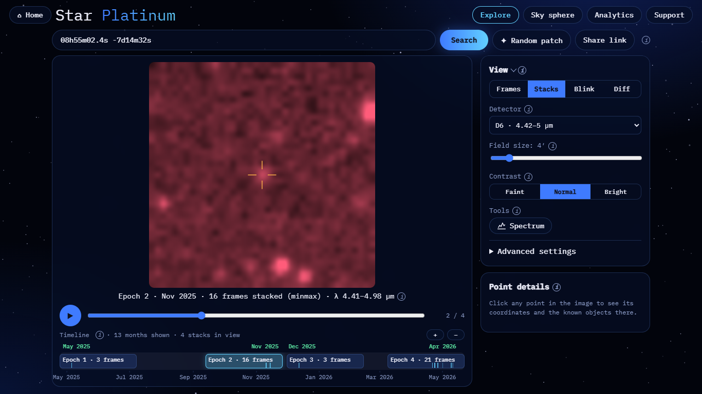
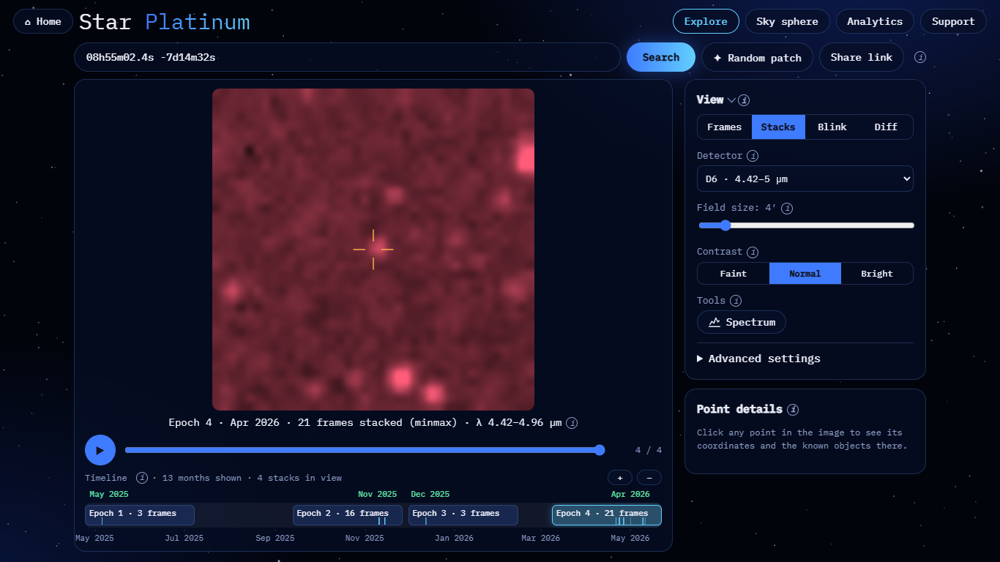
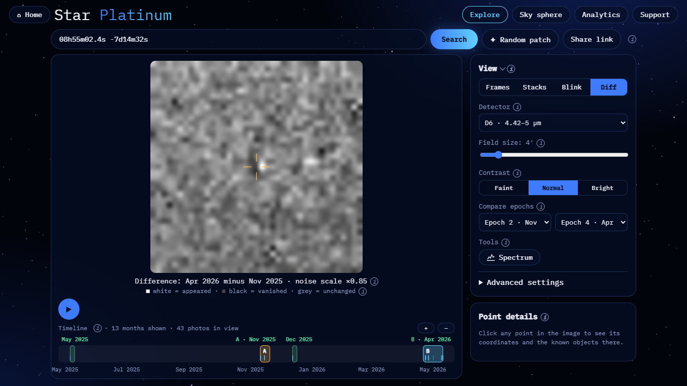
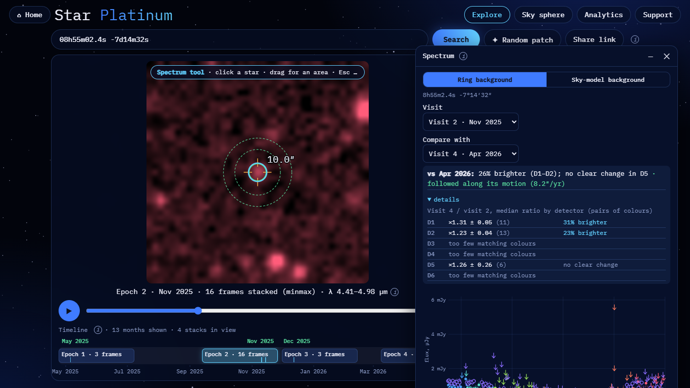

# WISE 0855−0714: proper motion

**Result: the motion is not visible. The object is detected only at the limit.** WISE 0855 is the coldest known
brown dwarf (a Y dwarf). In SPHEREx it shows up at S/N ≈ 5 per epoch in D6 at best, and the motion between
well-covered epochs (3.7″, 0.6 px) is smaller than one pixel. Within the errors we cannot confirm it.

| | |
|---|---|
| Detector | D6 (4.42–5.00 µm), where a Y dwarf is brightest; D5 is weaker (S/N 3.4–4.3) |
| Field | 4′ |
| Epoch A | Epoch 2, Nov 2025: 16 frames. This is the epoch of the query position |
| Epoch B | Epoch 4, Apr 2026: 21 frames. The other two epochs have 2 and 3 frames only |
| Pixel | 6.15″ |

## Reproduce

- Epoch A: <https://blink-comparator.de/?q=08h55m02.4s+-7d14m32s&det=6&fov=4&mode=stacks&same=1&i=1#explore>
- Epoch B: <https://blink-comparator.de/?q=08h55m02.4s+-7d14m32s&det=6&fov=4&mode=stacks&same=1&i=3#explore>
- Diff: <https://blink-comparator.de/?q=08h55m02.4s+-7d14m32s&det=6&fov=4&mode=diff&same=1&ea=1&eb=3#explore>
- Spectrum: <https://blink-comparator.de/?q=08h55m02.4s+-7d14m32s&det=6&fov=4&mode=stacks&same=1&i=1&tool=spectrum#explore>.
  Alt+click the crosshair (a normal click finds no point source), set Visit → Nov 2025 and
  Compare with → Apr 2026.

## What is seen

| Epoch A | Epoch B | Diff (B − A) |
|---|---|---|
|  |  |  |

- **Stacks.** At the crosshair there is at most a faint smudge, comparable to the noise grain. Field stars nearby
  are much brighter.
- **Diff.** There is a small dark / light pair at the crosshair, with the light side to the west. That is the
  expected direction (−RA), but its amplitude is at the noise level, so we do not count it as a detection of motion.
- **No blink GIF.** The source is not visible in a single stack.
- **Spectrum window.** The motion is found: Gaia DR3 does not contain WISE 0855 (it is too faint), so the page falls
  back to SIMBAD, which gives WISEA J085510.74−071442.5 at 8152 mas/yr. The window shows "followed along its motion
  (8.2″/yr)".
- **The "26% brighter (D1–D2)" is not a real brightening.** At 0.75–1.6 µm a Y dwarf is far below the noise, so the
  circle measures background and neighbour light there. Only D5 has matching colours where the object emits
  (×1.26 ± 0.26: no clear change).

## Numbers

| | Value |
|---|---|
| S/N per epoch, D6 (2 / 15 / 3 / 20 frames) | 1.3 / 5.0 / 3.7 / 5.0 |
| S/N per epoch, D5 | 4.3 / 4.3 / 3.4 / 4.1 |
| Expected motion Nov 2025 → Apr 2026 (0.46 yr, SIMBAD / Kirkpatrick+2019) | −3.70″, +0.31″ = 3.7″ = 0.60 px |
| Measured centroid shift, D6, relative to 10 field stars | −1.97 ± 1.28″, +0.85 ± 1.30″ (1.3σ from expected, error ≈ motion) |
| Shift-and-add of all 40 D6 frames (`demo/shift_and_add.py`) | detected at S/N 5.3–5.8; the S/N map over trial motions is flat (≤ 0.6 S/N), so the motion is not constrained |

**Why it fails.**
- The object is at the detection limit of one epoch, and the centroid error at S/N 5 (~FWHM / S/N ≈ 1.8″) is as
  large as the motion.
- The well-covered epochs are only 0.46 yr apart.
- Better options: a second year of data (a ~2 yr baseline gives ~16″ ≈ 2.6 px), or stacking only the
  longest-wavelength bands of D6.

Source: `demo/target_check.py`, `demo/shift_and_add.py` (2026-11-07), `docs/results/target_check_2026-11-07.md`,
`docs/results/wise0855_*.png`; screenshots taken with `docs/ui/tools/target_screens.py`.
